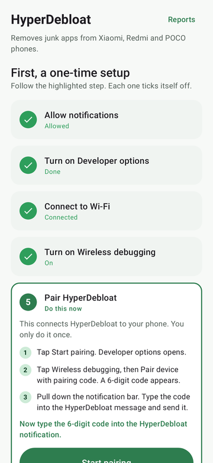
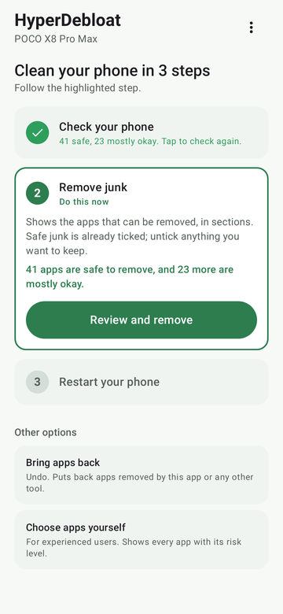
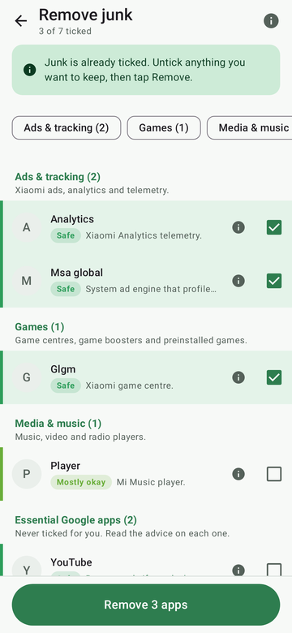
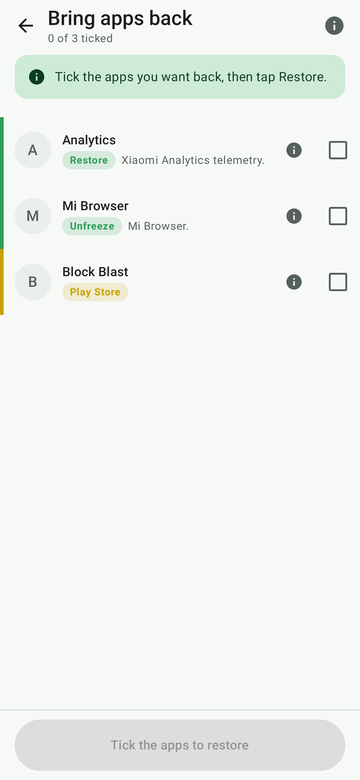

# HyperDebloat for Android

**Remove junk apps from Xiaomi, Redmi and POCO phones, on the phone itself. No root, no PC, no second app.**

[**⬇ Download the latest version**](https://github.com/KayYesR/HyperDebloat--Android/releases/latest)

- Checks every app on **your** phone and rates how safe it is to remove: from what the phone itself reports, cross-checked with three community debloat lists.
- Ticks only the safe junk for you, sorted into sections: ads and tracking, games, Xiaomi apps, Google apps and more.
- Everything can be undone with **Bring apps back**.

 Android version of the Windows tool [HyperDebloat](https://github.com/KayYesR/HyperDebloat).

## What you need

- A Xiaomi, Redmi or POCO phone with **Android 11 or newer** (HyperOS, or MIUI on Android 11 or newer).
- **Wi-Fi.** Any network works, including another phone's hotspot, and it does not need internet. Your phone's own hotspot does not work: Android does not allow it.
- About **10 minutes** the first time. After that, opening the app is enough.

## 1. Install

1. Open the [latest release](https://github.com/KayYesR/HyperDebloat--Android/releases/latest) on your phone and tap **HyperDebloat-x.x.x.apk** to download it.
2. Open the downloaded file. If the phone asks, allow your browser or file manager to install apps.
3. If a security scan warns you about an unknown app, choose to install anyway. HyperDebloat is open source: everything it does is in this repository.

> **Installed a test build before?** Uninstall it first. Releases are signed with a different key, so Android will not install one over a test build.

## 2. One-time setup

Open HyperDebloat. It shows five steps, highlights the one to do now, and ticks each off by itself. A bar at the bottom always says what the app is waiting for.

| Step | What to do |
|---|---|
| **1. Allow notifications** | Tap **Allow notifications**, then **Allow**. You will type the pairing code into a notification; that is all it is used for. |
| **2. Developer options** | Tap **Open About phone**, then tap **OS version** 7 times until it says you are a developer. Come back to HyperDebloat. |
| **3. Wi-Fi** | Connect to any Wi-Fi network. |
| **4. Wireless debugging** | Tap **Open Developer options** (on HyperOS: Settings › Additional settings › Developer options). Scroll to **Wireless debugging**, switch it on and tap **Allow**. |
| **5. Pair** | Tap **Start pairing**. In Developer options, tap the words **Wireless debugging** (not the switch), then **Pair device with pairing code**. A 6-digit code appears. Pull down the notification bar, tap **Enter code** on the HyperDebloat notification, type the code and send it. |

Pairing is needed only once. If the notification has no **Enter code** box, tap **No reply box in the message? Type the code here** in HyperDebloat and use split screen (Settings on one half, HyperDebloat on the other).

## 3. Clean your phone

| Step | What happens |
|---|---|
| **1. Check your phone** | Tap **Check now**. HyperDebloat reads every app and rates it. Nothing is changed. The bar at the bottom shows how far it has got. |
| **2. Remove junk** | Tap **Review and remove**. The removable apps are listed in sections. **Safe** junk is already ticked. Look through each section, untick anything you use, then tap **Remove**. |
| **3. Restart your phone** | Tap **Restart now**. Afterwards, check calls, camera, GPS, payments and fingerprint. |

Tip: open the apps you use most just before **Check now**, so the check can see what they rely on.

### What the colours mean

| Label | Meaning | Ticked for you? |
|---|---|---|
| 🟢 **Safe** | The phone and all three lists agree it is junk. | Yes |
| 🟩 **Mostly okay** | Very likely junk, but not every source confirms it. | No: your choice |
| 🟡 **Minor risk** | A small feature may stop working. | No |
| 🟠 **Risky** | A notable feature may stop working. | No, and it cannot be ticked in Remove junk |
| 🔴 **Unsafe** | Can stop the phone working properly. | No, and it cannot be ticked in Remove junk |
| ⚪ **Unknown** | No list knows what it does. | No |
| 🔵 **App** | An ordinary app (installed by you or at setup). | No |

Tap **ⓘ** on any app to see why it got its rating.

**Essential Google apps** (Play Store, Play services, Google app, Chrome, Gmail, YouTube, Meet, Maps) have their own box with one line of advice each. They are never ticked for you. Play Store and Play services can never be removed.

### Other options

- **Bring apps back**: undo. Lists everything removed, disabled or frozen, by HyperDebloat or any other tool. Tick what you want back and tap **Restore**.
- **Choose apps yourself**: for experienced users. Every app on the phone, colour-coded, with search. Opening it and going back is a way to see the ratings without changing anything.
- **⋮ menu**: **Reports** (saved check results and logs, tap to share), **Work without Wi-Fi** ([see below](#work-without-wi-fi)).

## Troubleshooting

**It shows "Reconnect" and asks me to turn Wireless debugging on again.**
Normal. Android switches Wireless debugging off by itself whenever Wi-Fi disconnects or the phone moves to another access point (mesh Wi-Fi, or a router switching between 2.4 and 5 GHz). It may also be off after a restart. Turn it back on; pairing and your last check (for 12 hours) are kept. To avoid this, turn on **Work without Wi-Fi** in the ⋮ menu.

**Pairing does not finish.**
Keep the **Pair device with pairing code** screen open while you type the code. If the code is wrong or expired, close that screen, open it again for a new code, and send the new one.

**The notification has no box to type the code.**
Use **Type the code here** in HyperDebloat with split screen (see step 5).

**The phone asks "Allow USB debugging?"**
Tap **Always allow** only when HyperDebloat just asked for it (turning on **Work without Wi-Fi**). Otherwise tap **Cancel**.

**The check failed.**
Tap **Try again**. If it fails again, tap **Show details** and send the text to the developer (see [Reporting a problem](#reporting-a-problem)).

**Some apps were frozen instead of removed.**
HyperOS refuses to remove some apps. HyperDebloat then freezes them: they stay installed but greyed out, cannot open and show no notifications. **Bring apps back** unfreezes them.

**A removed app came back.**
Some apps are put back by updates. The next **Check now** removes it again, and freezes it if it comes back a second time.

**Something stopped working after removing apps.**
Open **Bring apps back**, tick the app (the description says what it does) and tap **Restore**, then restart.

**My phone does not start any more.**
This can only happen if you removed apps marked Unsafe with **Choose apps yourself**. Without a computer, the only fix may be a factory reset, which erases the phone. Unsafe and Risky apps cannot be ticked in Remove junk.

## Reporting a problem

Open an [issue](https://github.com/KayYesR/HyperDebloat--Android/issues) with your phone model and HyperOS version. Attach files from **⋮ › Reports** (tap a file to share it):

- `connection_log.txt`: for connection or pairing problems.
- `error_log.txt`: when something stopped with an error.
- the latest `report_….csv`: for a wrong rating.
- `raw_adb_output.txt`: turn on **⋮ › Save raw output for bug reports** first, then run **Check now** again.

## Privacy

HyperDebloat collects nothing and has no ads or analytics. Its only internet use is downloading the three public debloat lists from GitHub, at most once a day. Everything else stays on your phone.

# How it works

The rest of this page is for the curious and for developers.

## How ratings are decided

### Step 1: what depends on it, according to the phone

| Signal (read over ADB) | Effect |
|---|---|
| Persistent (Android keeps it running) | Red |
| Current default launcher, dialer, SMS app or keyboard | Red |
| Device administrator | Red |
| Provides location services (network/fused location, geocoding, geofencing) | Red |
| Another app is using its services or content providers right now | Orange |
| Active overlay on the Android framework, System UI or Settings | Orange |
| 5 or more other apps hold permissions it defines | Orange |
| 1 to 4 other apps hold permissions it defines | Yellow |
| Installed with the hardware drivers (`vendor` or `odm` partition) | Yellow at least |

No dependency means green. How a package is built (signed with the platform key, privileged, no app icon, running as a system user) is shown for information but does not count against it: on Xiaomi phones nearly every package, junk included, looks like that.

### Step 2: cross-check with the lists

The lists are [UAD-ng](https://github.com/Universal-Debloater-Alliance/universal-android-debloater-next-generation), [fadeltd/xiaomi-debloater](https://github.com/fadeltd/xiaomi-debloater) and [ovsky/hyperos-debloater](https://github.com/ovsky/hyperos-debloater), downloaded at most once a day. If GitHub is unreachable, the last saved copy is used.

- A list rates it higher than the phone does: the rating goes up to the list's rating.
- All three lists say it is junk and nothing red applies: green, or yellow if other apps clearly rely on it or it sits with the hardware drivers.
- The two lists that know it both say safe and nothing is using it right now: one step lower.
- Only one list knows it: never green, because it cannot be cross-checked.
- No list knows it: flagged grey, because nothing says what it does. Remove junk never offers it; Choose apps yourself lets you tick it after a warning.
- What ends up green is split in two: **Safe** when the phone and all three lists agree, **Mostly okay** otherwise.

### Ordinary apps and setup junk

Apps that are not system apps are listed in blue. An app installed within 2 hours of the first app on the phone is tagged **Installed during setup**: on Xiaomi phones that is when the preloaded junk arrives. Apps restored from your backup arrive at the same time, so blue apps are never ticked for you. Ordinary apps are removed completely, so Bring apps back can only open their Play Store page.

YouTube, Chrome, Google Lens, Google Meet, WhatsApp, Instagram, Google Drive and Gmail are never ticked for you, even on phones where they have no icon. Before anything is removed, the confirmation names every ticked app that has an icon on the home screen.

### Essential Google apps

Remove junk lists these in a box of their own, never ticked, each with one line of advice:

| App | Advice |
|---|---|
| Play Store, Google Play services | Locked everywhere, including Choose apps yourself. Apps cannot be installed, updated or run properly without them. |
| Google app | Kept at orange: search, Assistant and the Discover feed need it. |
| Chrome | Removable only when another browser is set as default. |
| Gmail, YouTube, Google Meet, Google Maps | Remove only if you don't use it. |

### Packages HyperDebloat needs while it runs (Android version only)

Because the app runs on the phone it is cleaning, a few packages are locked (shown red, cannot be ticked), besides the Play Store and Google Play services: Settings (holds the Wireless debugging switch and pairing screen), Shell (runs the commands), System UI (shows the pairing notification), the package installers (show the phone's own uninstall screen), and the network stack and Wi-Fi resources (keep the Wi-Fi connection that wireless debugging runs over). HyperDebloat itself is left out of the list.

## Differences from the Windows version

- Android 11 or newer only, and Wi-Fi is needed to connect (see [Without Wi-Fi](#without-wi-fi)).
- The live-connection check sees fewer apps while HyperDebloat is on screen, because the others are in the background. Open the apps you rely on just before checking.
- The packages above are locked.
- App names and icons are shown next to package names (display only; they do not affect ratings).
- No dry-run mode: open Choose apps yourself and press Back to see the ratings without changing anything.
- Play Store and Google Play services are locked.

## Safety

- System apps are removed for your user only (`pm uninstall -k --user 0`) and can always be restored. Nothing is deleted from the system partition, OTA updates keep working, and a factory reset restores everything.
- Bring apps back does not depend on this app's logs: it reads the phone's own record of removed, disabled and frozen packages.
- After each removal the app checks the package is really gone; some HyperOS versions answer `Success` and keep it.
- Packages MIUI/HyperOS refuses to remove (`Failure [-1000]`) can be offered to the phone's own uninstall screen. Anything still refused is frozen.
- Every check saves a dated report: phone model, HyperOS build, every rating, the phone's evidence, the lists' ratings and the final reasoning. Removals are logged too. Copies are written to `Documents/HyperDebloat/<model>_<build>/` on the phone.
- On the phone itself there is no PC to recover from a bootloop. If you remove red packages and the phone stops booting, the fix may be a factory reset.

## Keeping removed apps gone

Without root, no tool can stop Android putting an app back. HyperDebloat does what the phone allows:

1. **Update removed first.** If a system app runs an update from the Play Store or GetApps, the update is removed before the app (`pm uninstall-system-updates`, the same idea as Canta's *Reset to factory version*).
2. **Frozen if the phone will not remove it.** If the phone refuses the removal, keeps the app despite `Success`, or reinstalls it within seconds, the app is frozen instead (`pm suspend`): it stays on the phone with a greyed-out icon, cannot open, and its notifications are hidden.
3. **Removed again if it comes back, frozen if it comes back twice.** Every check looks at the apps you removed. The first time one returns, it is removed again. If it returns a second time, it is frozen in place. The phone's log from that moment is saved as `came_back_<date>.txt` under Reports.

If you want an app back that you removed, use **Bring apps back** (not the Play Store), so the app knows to leave it alone.

## Work without Wi-Fi

Android only allows wireless debugging while the phone is connected to a Wi-Fi network as a client; its own hotspot does not count. The only tools that remove that limit need root ([nowifi-adb](https://github.com/iflyabd/nowifi-adb), [hotspotadb](https://github.com/droserasprout/io.drsr.hotspotadb)).

Without root, HyperDebloat offers **Work without Wi-Fi** (⋮ menu): after connecting once over Wi-Fi, the phone's ADB service also listens on `127.0.0.1:5555` (the same as `adb tcpip 5555`, and the same idea as the TCP mode in [thedjchi's Shizuku](https://github.com/thedjchi/Shizuku/wiki/Features)). You can then turn Wi-Fi off. Android closes that port when the phone restarts, so Wi-Fi is needed once after each restart; HyperDebloat switches the mode back on by itself. While it is on, other devices on the same network can ask for ADB access too: the phone shows an "Allow USB debugging?" prompt, and you should only allow it when HyperDebloat asks.

## Releasing (maintainer notes)

To release, push the code to `main`, then on GitHub open **Releases › Draft a new release**, create a new tag such as `v0.7.1` and publish it. The tag starts the build workflow, which builds a signed APK and attaches it to that release a few minutes later. Release version codes are 100 plus the workflow run number, so they always increase. The workflow needs four repository secrets (Settings > Secrets and variables > Actions):

| Secret | Value |
|---|---|
| `KEYSTORE_BASE64` | The release keystore (`.jks`) encoded as base64. In PowerShell: `[Convert]::ToBase64String([IO.File]::ReadAllBytes("hyperdebloat.jks")) \| Set-Clipboard` |
| `KEYSTORE_PASSWORD` | Keystore password |
| `KEY_ALIAS` | Key alias |
| `KEY_PASSWORD` | Key password |

Keep the keystore safe: every update must be signed with the same key, or phones refuse to install it over the old version. Pushes to `main` build a debug APK, available under the workflow run's artifacts.

## Building

Android Studio, or `./gradlew assembleDebug` with JDK 17 and the Android SDK (platform 35).

## Credits

Made by **kayyesr**, perfected by **Claude** (Anthropic, Claude Opus 5.5).

Package descriptions and cross-check data come from the [UAD-ng](https://github.com/Universal-Debloater-Alliance/universal-android-debloater-next-generation), [fadeltd/xiaomi-debloater](https://github.com/fadeltd/xiaomi-debloater) and [ovsky/hyperos-debloater](https://github.com/ovsky/hyperos-debloater) projects and their contributors. The lists are downloaded at run time and are not included in this repository.

Wireless debugging is handled by [libadb-android](https://github.com/MuntashirAkon/libadb-android) (Apache-2.0), with [Conscrypt](https://github.com/google/conscrypt) (Apache-2.0) and [Bouncy Castle](https://www.bouncycastle.org/) (MIT-style licence). The pairing-by-notification approach follows [Shizuku](https://github.com/RikkaApps/Shizuku); the update-first removal follows [Canta](https://github.com/samolego/Canta).

## Licence

MIT - see [LICENSE](LICENSE). Use at your own risk: removing system packages can break features, and in the worst case may need a factory reset.
